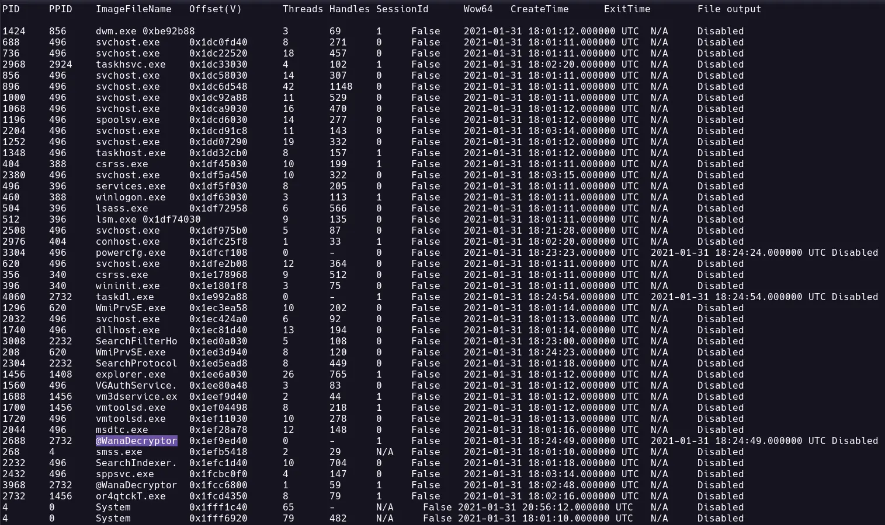
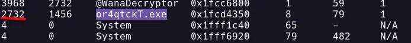
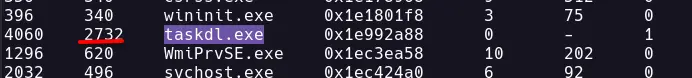
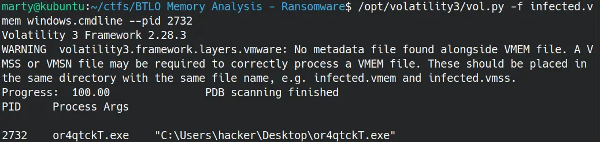
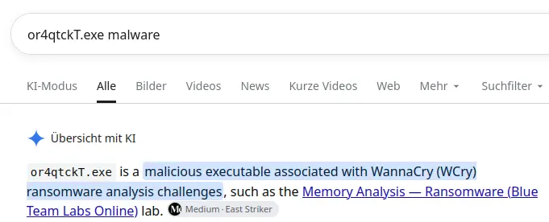
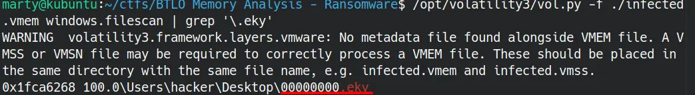

# Volatility3

https://blueteamlabs.online/home/challenge/memory-analysis-ransomware
## The Account Executive called the SOC earlier and sounds very frustrated and angry. He stated he can’t access any files on his computer and keeps receiving a pop-up stating that his files have been encrypted. You disconnected the computer from the network and extracted the memory dump of his machine and started analyzing it with Volatility. Continue your investigation to uncover how the ransomware works and how to stop it!

## Run “vol.py -f infected.vmem --profile=Win7SP1x86 psscan” that will list all processes. What is the name of the suspicious process?

@WannaDecryptor

## What is the parent process ID for the suspicious process?
2732 - Look in the column PPID

## What is the initial malicious executable that created this process?

## If you drill down on the suspicious PID (vol.py -f infected.vmem --profile=Win7SP1x86 psscan | grep (PIDhere)), find the process used to delete files

## Find the path where the malicious file was first executed

## Can you identify what ransomware it is?
WannaCry  

## What is the filename for the file with the ransomware public key that was used to encrypt the private key? (.eky extension)

