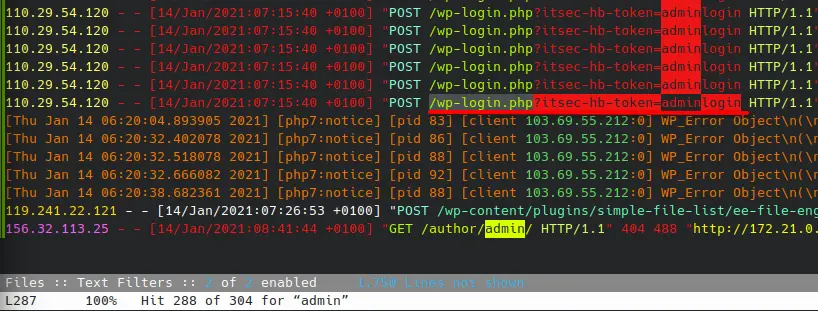
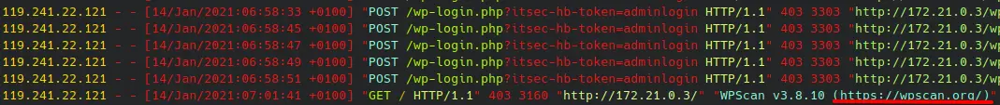
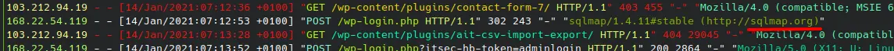
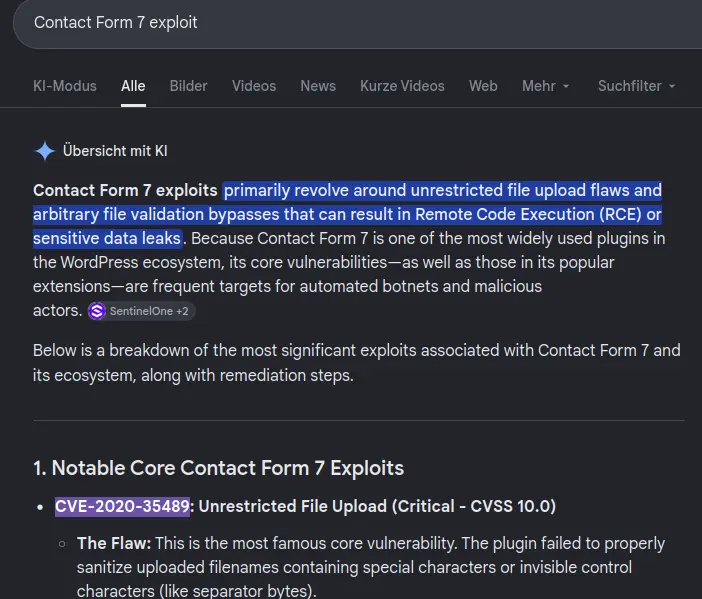
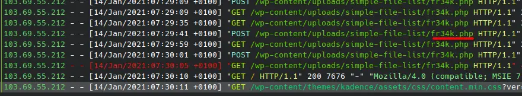
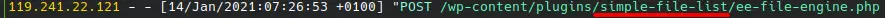
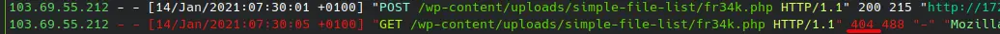

# WordPress Attack Analysis
https://blueteamlabs.online/home/challenge/log-analysis-compromised-wordpress

One of our WordPress sites has been compromised but we're currently unsure how. The primary hypothesis is that an installed plugin was vulnerable to a remote code execution vulnerability which gave an attacker access to the underlying operating system of the server.

## Identify the URI of the admin login panel that the attacker gained access to (include the token)

Using lnav. Filtering for "admin" and filtering out a private IP address

## Can you find two tools the attacker used?

Searching through the traffic caused by the attacker IP adresses

## The attacker tried to exploit a vulnerability in ‘Contact Form 7’. What CVE was the plugin vulnerable to? (Do some research!)

## What is the name of the PHP web shell file?

## What plugin was exploited to get access?

## What was the HTTP response code provided when the web shell was accessed for the final time?

