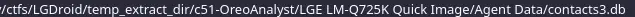
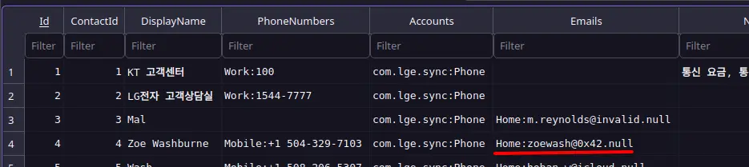
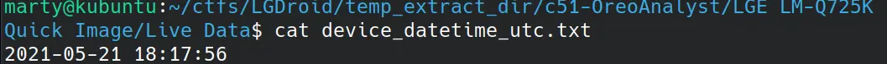
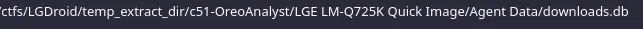
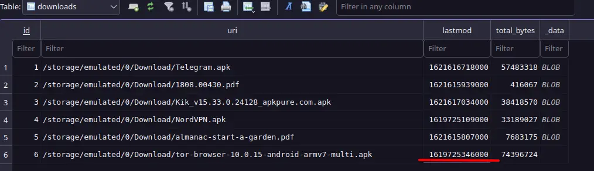
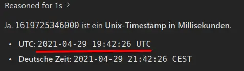
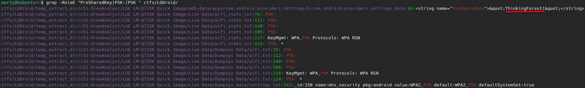
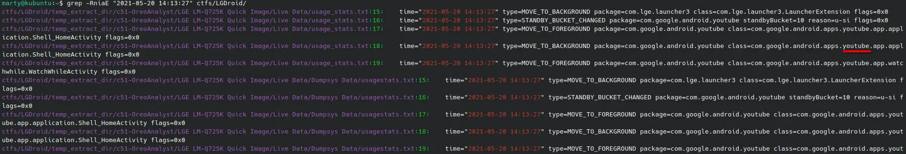
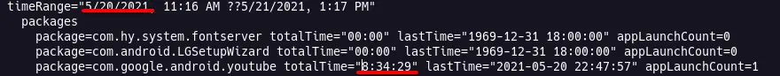

https://cyberdefenders.org/blueteam-ctf-challenges/lgdroid/

Analyze Android disk images using SQLite, Python, and log analysis to reconstruct user activity and extract key forensic artifacts.

## What is the email address of `Zoe Washburne`?

Using the DB Browser for SQLite.
Finding the contact Zoe Washburne in:

## What was the device's DateTime in UTC at the time of acquisition?

Searching through the provided files and finding a DateTime file

## What time was the `Tor Browser` downloaded in UTC?

Finding the lastmod value in the downloads database

Umkodierung:

## What is the password for the most recently connected WIFI access point?

Searching the provided data for PSK: oder PreSharedKey

## What app was the user focused on at `2021-05-20 14:13:27`?

## How long did the suspect watch YouTube on `2021-05-20`?

You can find the information in the usage_stats.txt file
